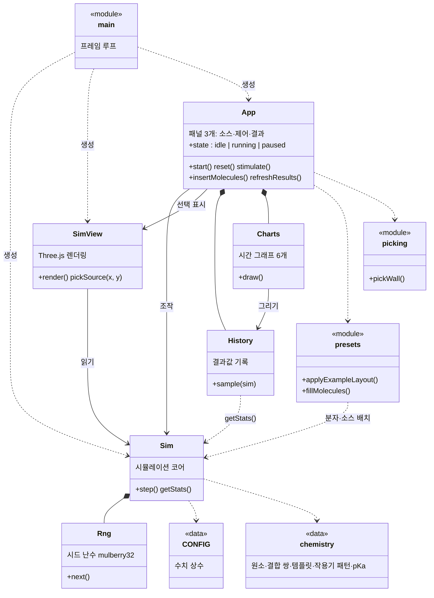
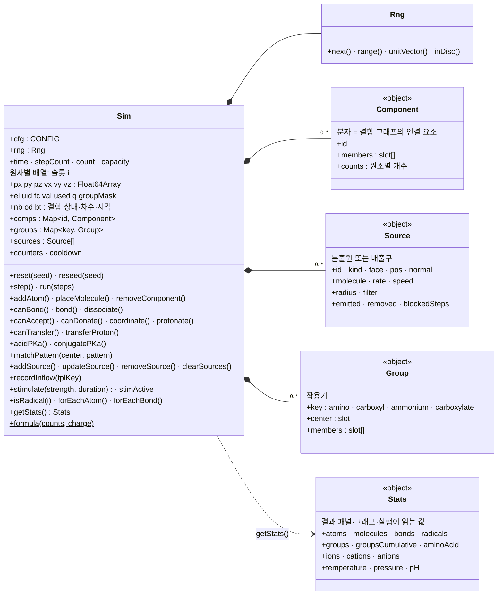
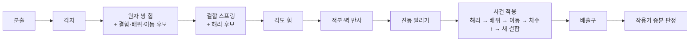

# 클래스 다이어그램

웹 데모의 구조를 클래스 다이어그램으로 정리했다(2026-11 기준, 커밋 `8225b9b`). 클래스는 6개(`Sim`, `Rng`, `SimView`, `App`, `History`, `Charts`)다. JS에서는 클래스가 아닌 일반 객체로 쓰는 것(분자, 소스, 작용기)과 데이터 모듈(`config.js`, `chemistry.js`)은 `<<object>>`, `<<data>>`, `<<module>>`로 표시했다. 밑줄(`_`)로 시작하는 내부 메서드는 대부분 뺐다.

- **원자는 객체가 아니다**: `Sim`이 원자마다 슬롯 번호 `i`를 주고, 위치·속도·원소·형식 전하 등을 배열(`px[i]`, `el[i]`, `fc[i]` …)에 나눠 담는다(SoA). 결합은 `nb[i]`(상대 슬롯)·`od[i]`(차수) 목록이다. Unity 이식 때 `NativeArray`로 옮기기 쉽게 하려는 구조다(`unity-port.md` 3절).
- **코어(`src/core`)는 화면과 무관하다**: `Sim`은 DOM·Three.js를 모르고, 화면 쪽(`SimView`, `App`, `History`, `Charts`)이 `Sim`을 읽거나 호출한다.

## 1. 전체 구조

화살표: `*--` 소유(만들고 들고 있음), `-->` 참조해서 호출, `..>` 사용(데이터를 읽거나 함수를 부름).

## 2. Sim 상세 (코어)

## 3. 한 스텝의 흐름 (`Sim.step`)

자세한 순서와 난수 소비는 [`unity-port.md`](unity-port.md) 2절.
